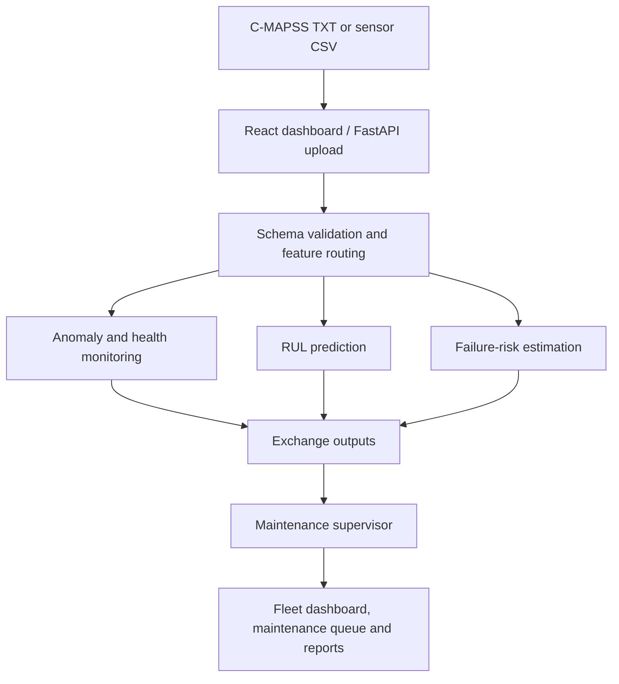

# AeroTwin OS

### Autonomous aircraft predictive maintenance and health monitoring

[](Backend/requirements.txt)
[](Frontend/package.json)
[](Frontend/package.json)
[](Backend/main.py)

**Turn turbofan sensor histories into anomaly evidence, health trajectories, remaining-life estimates and maintenance recommendations.**

AeroTwin OS is an integrated research prototype built around the NASA C-MAPSS turbofan degradation dataset. A React dashboard connects to a shared FastAPI backend, where anomaly and health monitoring, remaining useful life prediction, failure-risk estimation and a maintenance supervisor work on the same uploaded engine data.

The platform supports simulator-based analysis and maintenance decision support. Its maintenance actions are software recommendations for review; benchmark results do not establish performance on an operational aircraft fleet.

[Features](#features) · [Architecture](#architecture) · [Getting started](#getting-started) · [API](#api) · [Research and results](#research-and-results) · [Documentation](#documentation)

## Features

| Component | What it provides |
| --- | --- |
| **Anomaly detection and health monitoring** | Operating-mode normalisation, a healthy sensor reference, causal commissioning, four-detector score fusion, continuous health indices and health states. |
| **Remaining useful life (RUL)** | Per-subset temporal convolutional network models, interval estimates and engine lifecycle trajectories. |
| **Failure risk** | Bidirectional LSTM models for failure-risk horizons of 10, 30 and 50 operating cycles, with optional Monte Carlo dropout uncertainty. |
| **Maintenance supervisor** | Fusion of upstream predictions into maintenance recommendations using a saved policy, explicit decision rules and confidence handling. |

The anomaly component combines **Isolation Forest**, **Ledoit–Wolf covariance distance**, an **LSTM autoencoder** and a **residual rule**. Its sensor reference uses random forest, XGBoost, LightGBM and a dense neural regressor. Residual rankings, reference-prediction explanations and health decompositions support interpretation of the monitoring outputs.

The dashboard includes fleet overview, upload and execution, health monitoring, anomaly detection, RUL, failure risk, digital twin, AI reasoning, confidence, maintenance queue, reports and settings pages. Results come from backend services and persisted outputs.

## Architecture



Each prediction component applies its own persisted preprocessing and model references. The integration layer routes raw features and joins outputs by engine and cycle. Uploading through `/integration/run-full` runs inference with saved artifacts; training is a separate offline workflow.

## Technology stack

| Layer | Technologies |
| --- | --- |
| Frontend | React 18, TypeScript, Vite, Tailwind CSS, React Query, Recharts |
| API | FastAPI, Uvicorn, Pydantic |
| Data and machine learning | NumPy, pandas, SciPy, scikit-learn, XGBoost, LightGBM |
| Neural models | TensorFlow / Keras, PyTorch |
| Interpretation and tracking | SHAP, NetworkX, MLflow, structured logs and JSON metrics |

Dependency versions are defined in [Backend/requirements.txt](Backend/requirements.txt) and [Frontend/package.json](Frontend/package.json). The frontend also includes an npm lockfile.

## Getting started

### 1. Clone the repository

```bash
git clone https://github.com/sadushan3/Autonomous_Aircraft_Maintainance.git
cd Autonomous_Aircraft_Maintainance
```

You need **Python 3.10 or 3.11**, **Node.js 22.x**, **npm** and **Git**. The examples below use Python 3.11.

### 2. Prepare the data and saved models

**A fresh clone does not include the trained model bundles or the raw NASA dataset.** These directories are excluded from Git. Installing dependencies starts the application services, but inference also requires the matching models, scalers, feature lists and calibration metadata.

Download the classic FD001–FD004 data from the [NASA C-MAPSS dataset page](https://data.nasa.gov/dataset/cmapss-jet-engine-simulated-data). Place the files in:

```text
Backend/data/raw/
├── train_FD001.txt ... train_FD004.txt
├── test_FD001.txt  ... test_FD004.txt
└── RUL_FD001.txt   ... RUL_FD004.txt
```

Restore the saved model bundles for the components you intend to run:

| Component | Default location |
| --- | --- |
| Anomaly and health references, detectors and calibration | `Backend/models/`, including `scalers/` |
| RUL models, scalers and feature metadata | `Backend/models/Predictive_Maintenance/RUL_Lifecycle/` |
| Failure-risk models, scalers and metadata | `Backend/models/Predictive_Maintenance/Failure_Risk/` |
| Supervisor models and supporting artifacts | `Backend/models/Maintenance_Supervisor/` and `Backend/artifacts/Maintenance_Supervisor/` |

Obtain compatible bundles from the project maintainer or regenerate them using the component training workflows. The repository does not currently provide a single command that trains every component from scratch. The [predictive artifact loader](Backend/app/services/Predictive_Maintenance/artifact_loader.py) documents its model-file discovery patterns.

### 3. Start the backend

From the repository root, on **Windows PowerShell**:

```powershell
py -3.11 -m venv .venv
.\.venv\Scripts\python.exe -m pip install --upgrade pip
.\.venv\Scripts\python.exe -m pip install -r Backend\requirements.txt
cd Backend
..\.venv\Scripts\python.exe -m uvicorn main:app --reload --port 8000
```

<details>
<summary>macOS / Linux commands</summary>

From the repository root:

```bash
python3.11 -m venv .venv
source .venv/bin/activate
python -m pip install --upgrade pip
python -m pip install -r Backend/requirements.txt
cd Backend
python -m uvicorn main:app --reload --port 8000
```

</details>

| Service | Local address |
| --- | --- |
| Backend liveness | <http://127.0.0.1:8000/health> |
| Interactive API documentation | <http://127.0.0.1:8000/docs> |
| OpenAPI schema | <http://127.0.0.1:8000/openapi.json> |
| Predictive model availability | <http://127.0.0.1:8000/predictive-maintenance/artifacts/status> |

The liveness endpoint confirms that the API responds. Check model availability separately before running predictions.

### 4. Start the frontend

Open a second terminal at the repository root:

```bash
cd Frontend
npm ci
npm run dev
```

Open **<http://localhost:5173>**. During development, Vite forwards `/api/*` requests to `http://127.0.0.1:8000` and removes the `/api` prefix.

### 5. Run an analysis

1. Open **Upload & Run** in the dashboard.
2. Upload a classic C-MAPSS `.txt` file or a CSV containing the expected raw columns.
3. Run the integrated pipeline using your saved model bundles.
4. Inspect the fleet overview, individual engine histories, anomaly evidence and maintenance queue.

The input layout contains `unit`, `cycle`, three operating settings (`op_setting_1`–`op_setting_3`) and 21 sensor channels (`sensor_1`–`sensor_21`). Keep the FD subset identifiable in the filename, such as `test_FD001.txt`, or supply the appropriate `subset_id` in a CSV. Official test RUL files are evaluation labels, not model inputs.

Before the first successful integrated run, some dashboard panels show an empty state because no decision outputs exist yet. Short histories may also be ineligible for commissioning or prediction windows.

## API

Use Swagger at `/docs` to inspect request schemas and try the available endpoints.

| Method | Endpoint | Purpose |
| --- | --- | --- |
| `GET` | `/health` | API liveness |
| `GET` | `/integration/feature-routing` | Inspect the upload and component feature contract |
| `POST` | `/integration/route-preview` | Validate an upload and preview routing without model inference |
| `POST` | `/integration/run-full` | Run anomaly/health, RUL, failure risk and supervisor fusion |
| `GET` | `/integration/dashboard` | Read integrated engine results |
| `GET` | `/integration/maintenance-queue` | Read maintenance recommendations |
| `GET` | `/anomaly-health/detector-config` | Inspect the detector configuration |
| `GET` | `/anomaly-health/evaluation/metrics` | Read available anomaly and health evaluation metrics |
| `GET` | `/predictive-maintenance/artifacts/status` | Check RUL and failure-risk artifact availability |

For example, from the repository root in **PowerShell**, validate a file before running inference:

```powershell
curl.exe -X POST "http://127.0.0.1:8000/integration/route-preview" -F "file=@Backend/data/raw/test_FD001.txt"
```

Run the full pipeline with dense RUL/failure-risk scoring and uncertainty disabled:

```powershell
curl.exe -X POST "http://127.0.0.1:8000/integration/run-full?stride=1&include_uncertainty=false" -F "file=@Backend/data/raw/test_FD001.txt"
```

`stride=1` scores every eligible RUL/failure-risk cycle. The API default, `stride=0`, chooses a stride from the upload size. A larger stride reduces intermediate prediction calls; it does not thin anomaly and health processing. Disabling uncertainty skips the Monte Carlo passes. Full trajectories can take substantial time to process.

The same integrated workflow is available from the command line. From `Backend/`, with the Python environment active:

```bash
python scripts/run_pipeline.py --input data/raw/test_FD001.txt --stride 1 --no-uncertainty
```

The runner records a manifest and checks available terminal RUL labels. It uses saved models and writes runtime outputs.

## Research and results

The repository includes an evidence-based study of **anomaly detection and health monitoring**. Its saved evaluation covers all four C-MAPSS subsets, with the following results:

| Measure | Reported result |
| --- | --- |
| Binary condition observations | 51,806 |
| Anomaly ROC AUC | 0.9952 |
| Precision | 0.8999 |
| Critical-condition recall | 0.6321 |
| F1 | 0.7426 |
| Healthy-condition false-alert observations | 181 / 49,232 |
| Critical-reaching engines detected | 131 / 159 |
| Health-index pooled Spearman correlation with RUL | 0.4601 |
| Tolerance-based health monotonicity pass fraction | 0.9477 |

Anomaly classification uses healthy (`RUL ≥ 125`) and critical (`RUL ≤ 30`) condition proxies after readiness checks; intermediate conditions are excluded from binary metrics. Health evaluation covers 104,897 observations from 707 engines. These are retrospective results on a previously inspected simulator benchmark. The supervised linear baseline has higher recall and F1 than the four-detector alert policy, although it produces more healthy false alerts.

See the [independent evidence audit](conference_iop_paper/evidence/independent_audit.json), [IOP manuscript](conference_iop_paper/IOP_Anomaly_and_Health_Monitoring.pdf) and [verified references](conference_iop_paper/Verified_References.md) for the definitions, populations and limitations. These figures describe the anomaly and health component, rather than an overall accuracy score for the complete platform.

## Project structure

```text
.
├── Backend/
│   ├── main.py                    # Shared FastAPI entry point
│   ├── app/
│   │   ├── config/                # Component configuration
│   │   ├── routers/               # API routes
│   │   ├── schemas/               # Request and response contracts
│   │   ├── services/              # Models, monitoring and integration
│   │   └── utils/                 # Shared and component utilities
│   ├── scripts/                   # Pipeline, training and evaluation tools
│   ├── tests/                     # Regression and contract checks
│   ├── data/                      # Local datasets and exchange files
│   ├── models/                    # Local trained bundles; excluded from Git
│   └── requirements.txt
├── Frontend/
│   ├── src/app/                   # Dashboard pages and UI components
│   ├── src/lib/                   # API client, types and data hooks
│   ├── src/styles/                # Application styles
│   └── package.json
├── conference_iop_paper/           # IOP draft, figures and evidence audit
├── research_paper/                 # IEEE draft and supplementary methods
├── EDA_figures/                    # Dataset analysis and visualisations
└── presentation/                   # Product deck and supporting notes
```

## Configuration and development

| Configuration | Location / mechanism |
| --- | --- |
| Anomaly and health defaults | [Component config](Backend/app/config/Anomaly_Health_Monitoring/config.py) |
| Anomaly and health overrides | JSON file through `AHM_CONFIG_FILE`, or environment variables such as `AHM_MLOPS__ENABLE_MLFLOW=false` |
| Predictive model root | `ARTIFACT_ROOT` in the environment or `Backend/.env`; defaults to `Backend/models/Predictive_Maintenance` |
| Supervisor paths and policy settings | [Supervisor config](Backend/app/config/Maintenance_Supervisor/supervisor_config.py) |
| Frontend development proxy | [Vite config](Frontend/vite.config.ts) |

From `Frontend/`:

```bash
npm run typecheck
npm run build
```

Backend checks include both `unittest` and pytest-style tests. From `Backend/`, with the Python environment active, install the test runner and select the suites relevant to your change:

```bash
python -m pip install pytest
python -m pytest tests/Anomaly_Health_Monitoring tests/Predictive_Maintenance
```

Some checks depend on local datasets or saved artifacts. A source-only checkout does not provide every evaluation input.

## Troubleshooting

| Symptom | Check |
| --- | --- |
| Dashboard cannot reach the API | Start FastAPI on port 8000 and Vite on port 5173; check the `/health` response. |
| Missing model or calibration error | Restore the complete matching bundle, including scalers, feature metadata and thresholds. Check predictive artifact status in `/docs`. |
| Empty dashboard | Complete an integrated run and check its stage results before opening result panels. |
| Some engines have no prediction | Check commissioning readiness and the subset-specific history window. |
| Pipeline takes a long time | Inspect the requested stride and uncertainty setting; dense whole-dataset inference makes many model calls. |
| Saved Keras model cannot be loaded | Install the TensorFlow and Keras versions specified in `Backend/requirements.txt`. |

## Documentation

- [Frontend setup and data flow](Frontend/README.md)
- [Predictive Maintenance component documentation](Backend/docs/Predictive_Maintenance/README_upstream.md)
- [Predictive Maintenance Postman collection](Backend/postman/Predictive_Maintenance/Predictive_Maintenance_Backend.postman_collection.json)
- [IOP research draft and rebuild instructions](conference_iop_paper/README.md)
- [IEEE research draft and supplementary methods](research_paper/README.md)
- [Dataset analysis figures](EDA_figures/)
- [Product presentation](presentation/AeroTwin_OS_Overall_Product_and_Commercialization.pdf)

## Contributions and attribution

Open an issue with the problem, relevant component and steps to reproduce it. For code contributions, describe the resulting behaviour and include relevant validation. Changes to thresholds, datasets or model bundles should identify the evaluation population and supporting evidence.

This repository does not currently include a project-wide license. Third-party frontend acknowledgements are listed in [Frontend/ATTRIBUTIONS.md](Frontend/ATTRIBUTIONS.md).
