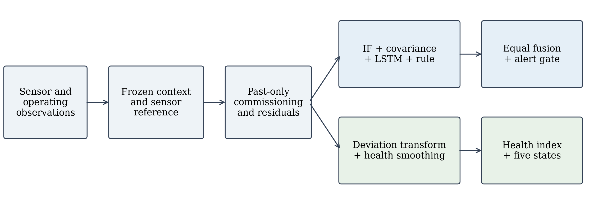
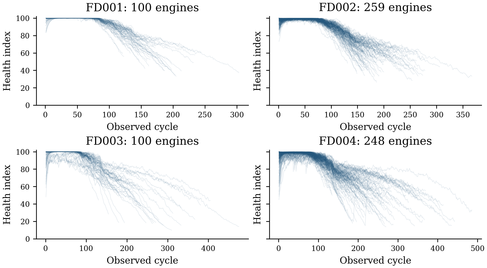

# Residual-based turbofan condition monitoring through anomaly fusion and continuous health assessment

Selvakumar Sadurshan

Affiliation: [department, institution, city and country to be supplied]

E-mail: sadushansadu33@gmail.com

Abstract. Changes in engine operating conditions can resemble deterioration, while a persistent sensor offset can make a healthy engine appear abnormal. This study examines an implemented monitoring component that addresses these effects before producing anomaly alerts and a continuous health index. A frozen operating-context reference and causal engine commissioning generate sensor residuals. Isolation Forest, shrinkage covariance distance, a long short-term memory autoencoder and a residual rule contribute equally to anomaly scoring; a separate exponentially smoothed transformation tracks health. Evaluation uses the four NASA C-MAPSS subsets, with engine-disjoint roles for fitting, calibration and development selection. On previously inspected official test trajectories, the anomaly score achieves a receiver operating characteristic area of 0.9952. The deployed alert policy yields precision of 0.8999, recall of 0.6321 and F1 of 0.7426, detecting critical-condition observations in 131 of 159 eligible engines. The health index has a pooled Spearman correlation with remaining life of 0.4601 and a tolerance-based monotonicity pass fraction of 0.9477. A supervised linear baseline attains higher recall and F1, although it produces more healthy-condition false alerts. These findings support traceable condition monitoring and identify the current alert threshold as a limitation. The labels are remaining-life condition proxies, and benchmark reuse limits claims about unseen faults and external generalisation.

## 1. Introduction

An engine can change its sensor response without developing a new fault. Operating settings alter the expected response, and individual engines can have different baseline offsets. A monitoring system must account for both effects before interpreting a departure from normal behaviour. It must also preserve enough information to explain whether an alert reflects an isolated observation, a sustained deviation or a broader deterioration trend.

Health indicator construction and health stage assessment are established parts of machinery condition analysis [1]. An anomaly score and a health index serve different purposes within that process. The score describes how unusual an observation is relative to a reference population. A health index summarises how the observed condition evolves. Combining these outputs is useful only when their definitions, reference populations and evaluation measures remain explicit.

This paper studies the anomaly detection and health monitoring component of an implemented turbofan monitoring application. The study uses the Commercial Modular Aero-Propulsion System Simulation (C-MAPSS) benchmark, whose degradation simulation and public data provide reproducible engine trajectories [2,3]. Remaining useful life (RUL) is used offline to select reference regions and define evaluation bands. The component does not predict RUL in this study.

The contribution is an evaluated integration of established methods: context-conditioned residual generation with past-only commissioning, four-detector anomaly fusion, and a separate continuous health assessment. The evaluation distinguishes cycle decisions, engine events and health trajectories, and includes a simple supervised comparator. Its purpose is to establish what the implemented component demonstrably does. The work makes no claim to a new isolation algorithm, recurrent architecture or physical engine damage model.

## 2. Related work

Isolation Forest detects observations that can be separated through relatively few random partitions [4]. It provides a distributional measure of unusualness, but does not explicitly reconstruct temporal sequences. Covariance distance offers another view by measuring departures across correlated variables. The shrinkage estimator of Ledoit and Wolf improves covariance conditioning, which is useful when computing multivariate distances [5].

Malhotra et al. use a long short-term memory (LSTM) encoder-decoder to reconstruct normal multivariate sequences and identify deviations through reconstruction error [6]. This motivates a temporal detector alongside the distributional detectors. In the present implementation, a transparent residual rule supplies a fourth score. The combination is straightforward to inspect, although complementary mechanisms do not by themselves establish an improvement in detection performance.

Expected sensor behaviour is estimated using random forests [7], XGBoost [8], LightGBM [9] and a dense neural regressor. Their role is to provide a healthy statistical reference conditioned on operating context. The reference is not a thermodynamic simulator. The distinction matters because prediction error alone cannot identify a physical fault mechanism.

Evaluation practice also affects the apparent quality of anomaly detection. Kim et al. show that point adjustment can overestimate time-series detection performance [10]. This study retains the actual cycle decisions and reports engine-level events separately. Local feature attribution follows the SHAP framework [11], but the explained object is the sensor-reference prediction. Reference attribution, residual ranking and physical root-cause validation are treated as separate tasks.

## 3. Monitoring method

### 3.1. Inputs, operating context and reference construction

For engine i at cycle t, the input contains three operating settings and 21 sensor channels. Engine and cycle identify each observation, with distinct identities across subsets and data partitions. Rows are ordered within each engine. Missing readings use preceding values from the same engine and then medians learned from fitting engines. Evaluation data do not supply new imputation or scaling statistics.

A saved k-means model assigns one of six operating modes in the pooled model. Sensor values are standardised using the saved mean and scale for their assigned mode:

x̃ᵢ,ₜ,ⱼ = (xᵢ,ₜ,ⱼ − μₖ,ⱼ) / σₖ,ⱼ    (1)

Here, x is a sensor reading, j identifies its channel, k is the operating mode, and μ and σ are frozen reference parameters. The regressors receive three mode-scaled operating settings, absolute cycle, clipped cycle/300 and six mode indicators. The resulting 11 inputs exclude current sensor targets, RUL and final trajectory length.

The random forest, XGBoost, LightGBM and dense neural reference predictions are combined using normalised inverse validation root mean squared error weights. The saved weights are 0.2511, 0.2391, 0.2503 and 0.2594, respectively. The forest uses 200 trees, maximum depth 14 and minimum leaf size four. XGBoost uses 250 trees, depth six and learning rate 0.08; LightGBM uses 300 trees, 31 leaves and learning rate 0.06. The neural reference has hidden layers of 128, 64 and 32 units, with ReLU activation, batch normalisation and dropout of 0.1. Its training uses Adam at learning rate 0.001, batch size 256 and early stopping within a maximum of 150 epochs.

### 3.2. Causal commissioning and residual generation

Commissioning estimates each engine's persistent offset during its first 30 observed cycles. At cycle t, the offset uses commissioning residuals strictly preceding t; it remains fixed after the commissioning period. For reference model m, let b denote this causal offset and w its ensemble weight. The monitoring residual is

rᵢ,ₜ,ⱼ = x̃ᵢ,ₜ,ⱼ − ∑ₘ wₘ [fₘ,ⱼ(zᵢ,ₜ) + bᵢ,ₜ,ⱼ⁽ᵐ⁾]    (2)

where f is a reference regressor and z denotes the 11 context and cycle inputs. This construction gives an observation-specific comparison against the expected response while accounting for individual baseline differences. The evaluated residual path uses the frozen context reference. Alert decisions require a complete 30-cycle commissioning prefix, so early rows and very short trajectories have reduced coverage.

Both monitoring branches use these residuals. Figure 1 shows their shared inputs and separate output transformations. Health calculation continues during commissioning; anomaly decisions are evaluated after readiness.

### 3.3. Residual detectors and score fusion

Isolation Forest uses 200 trees, automatic subsampling and random seed 42. Its negated decision function is mapped to an empirical percentile using a stored reference distribution. The covariance detector uses a trailing five-cycle residual mean and a Ledoit-Wolf covariance estimate. Its squared distance and bounded score are

D² = (r̄ − μᵣ)ᵀ Σ̂⁻¹ (r̄ − μᵣ); sM = D² / (D² + q₀.₉₉)    (3)

where r̄ is the trailing residual vector, μr and Σ̂ are fitted reference parameters, and q is the saved 99th percentile of healthy-reference distances. Covariance windows reset at observed cycle gaps.

The LSTM autoencoder uses 30-cycle residual windows. Its encoder has 64 and 32 units, and its decoder has 32 and 64 units with a time-distributed linear output. Dropout is 0.1. Training uses Adam at learning rate 0.001, batch size 128, at most 40 epochs and early-stopping patience of six epochs. A 0.15 validation fraction is drawn within fitting windows; it is not an independent engine-level performance estimate. Inference windows end at the current observation, with first-reading padding at the beginning of a trajectory. Mean squared reconstruction error is mapped through its saved empirical reference distribution.

The fourth detector combines average absolute residual magnitude with a penalty for large channel deviations:

uᵢ,ₜ = (1/p) ∑ⱼ |rᵢ,ₜ,ⱼ| + 0.5 ∑ⱼ I(|rᵢ,ₜ,ⱼ| > 3)    (4)

The indicator I equals one when its condition holds. All detectors receive residuals of the mode-standardised sensor channels. The constant three in equation (4) is therefore a residual-domain trigger; it is not a universal three-standard-deviation criterion. The rule statistic is also mapped to a stored empirical percentile.

The four bounded scores receive equal weights:

Sᵢ,ₜ = (sIF + sM + sAE + sR) / 4    (5)

A decision requires finite scores from all enabled detectors. The cutoff is the 99th percentile of fused scores on healthy calibration-engine rows with RUL at least 125 and cycle greater than 30. Its saved value is τ = 0.90851712540986. A ready observation is flagged when S > τ. These scores measure position relative to reference behaviour and are not calibrated fault probabilities.

A context-transition marker covers a mode-change observation and the next three observed rows. Within that marker, a flag is classified as operational until at least three consecutive flags occur. Other ready flags receive the software category 'fault'. Persistence resets at cycle gaps. This is a transition-specific guard, rather than a three-cycle delay applied to every alert. The category name does not convert the proxy labels into verified faults.

### 3.4. Continuous health assessment

Health calculation uses the same residuals and a separately fitted healthy deviation reference. The evaluated equal-channel policy computes mean absolute deviation d and transforms excess deviation into a bounded raw health value:

hrawᵢ,ₜ = 100 exp[−λ max(dᵢ,ₜ/d₀ − 1, 0)]    (6)

The saved reference d₀ is 0.3237016428571428, estimated from 27,698 healthy fitting-role rows; λ = 0.25. Exponential smoothing then gives the reported health index:

Hᵢ,ₜ = α hrawᵢ,ₜ + (1 − α) Hᵢ,ₜ₋₁    (7)

Here α = 0.2, and the first raw value initialises the sequence. A separate state score adds half the three-cycle projection of a trailing 20-observation health slope and clips the result to 0–100. Thresholds of 80, 60, 38 and 20 define Healthy, Degrading, Warning, Critical and Failure Risk, respectively. The continuous index and trend-adjusted state score are distinct outputs. These state names describe an operational assessment scale; their thresholds have not been validated against independent physical health measurements.

Residual rankings accompany the monitoring outputs. SHAP attributes the context and cycle contributions to the reference prediction, with commissioning offsets represented separately. It does not explain the complete fused detector as a single model. For the same reason, numerical attribution consistency is not evidence that an inferred physical root cause is correct.

## 4. Experimental design

### 4.1. Dataset and separation of engine roles

The four C-MAPSS subsets contain different operating-condition and degradation combinations [2,3]. FD001 and FD003 have one operating condition; FD002 and FD004 have six. FD001 and FD002 contain high-pressure compressor degradation, while FD003 and FD004 additionally include fan degradation. Table 1 reports counts reconstructed from the actual local data files. The FD004 counts follow those files because the current NASA catalogue description reverses the two trajectory totals.

Table 1. C-MAPSS observations reconstructed from the local source files.

| Subset | Train engines | Train rows | Test engines | Test rows |
| --- | --- | --- | --- | --- |
| FD001 | 100 | 20,631 | 100 | 13,096 |
| FD002 | 260 | 53,759 | 259 | 33,991 |
| FD003 | 100 | 24,720 | 100 | 16,596 |
| FD004 | 249 | 61,249 | 248 | 41,214 |
| Total | 709 | 160,359 | 707 | 104,897 |

The 709 training engines are assigned to 396 fitting, 85 calibration, 86 development-selection and 142 retrospective-confirmation roles. Their memberships are disjoint and persisted in one shared plan. Learned preprocessing, context models, reference regressors and health references use fitting engines. Selection engines support reference validation and ensemble weighting; calibration engines supply the fused cutoff. Confirmation and official test engines are excluded from these current fitting and selection operations.

Reference-regressor fitting selects rows with RUL at least 130 in the initial 30% of a fitting trajectory, while retaining its first ten rows. Isolation Forest, the autoencoder and the residual-rule reference use the early-region/RUL intersection. Covariance fitting uses healthy post-commissioning rows. These are offline population-selection rules. Serving-time scores use frozen models and available observations, without future lifetime information.

### 4.2. Labels, coverage and baseline

For each official test engine, cycle-level RUL is reconstructed from the final observed cycle and the supplied terminal RUL. Binary evaluation treats RUL ≥ 125 as healthy and RUL ≤ 30 as critical. The intermediate band, RUL 31–124, is excluded from binary classification metrics. This task measures separation of distant condition states and does not establish the time of physical fault onset.

The official test data contain 104,897 observations from 707 engines. Commissioning and readiness exclude 21,109 rows, leaving 83,788 rows from 690 engines. Seventeen engines provide no ready prediction. Of the ready rows, 31,982 belong to the intermediate band. Binary metrics therefore cover 51,806 rows: 49,232 healthy and 2,574 critical observations. Health evaluation uses all 104,897 rows and 707 engines.

The comparator is a fixed logistic regression using nine sensor channels: 2, 3, 4, 7, 11, 12, 15, 20 and 21. It uses L2 regularisation, C = 1, balanced class weights, the lbfgs solver, at most 1,000 iterations and cutoff 0.5. It is fitted on fitting-role proxy labels, with no hyperparameter search, and evaluated on the same binary rows. Its supervised objective differs from the healthy-reference learning used by the anomaly component; the comparison is an operational reference, not a matched-objective ablation.

### 4.3. Measures and evidence checks

Classification measures include precision, recall, F1, healthy-cycle false-alert rate, receiver operating characteristic area (ROC AUC) and average precision (AP). Confusion metrics use the context-gated category; ranking metrics use continuous scores. No point adjustment fills an interval after a successful detection. Engine-level measures count critical-reaching engines with at least one critical-band alert and healthy engines with false alerts. The reported 95% intervals use 300 whole-engine percentile-bootstrap samples with seed 20261011.

Health assessment reports pooled Spearman association with RUL and a tolerance-based monotonicity measure. An engine passes when no more than 15% of successive late-phase changes rise by more than one health point. Late phase begins after 30% of its final observed cycle and must contain at least five observations. Early-to-late health decrease compares endpoint medians over the smaller of 20 observations and one fifth of trajectory length, with a minimum window of one. No additional evaluation-time smoothing is applied.

The source data, saved scores, current models and evidence records were checked through file hashes. All 104,897 official test labels were reconstructed from the original files and aligned by engine and cycle. The four-score average and classification metrics were recomputed; health was recalculated from saved official residuals using the frozen reference. These checks reproduce existing experimental evidence. They do not constitute a new training run or a prospective trial.

## 5. Results

### 5.1. Anomaly discrimination and deployed alerts

The fused score achieves ROC AUC 0.9952 and AP 0.8860 on the two evaluation bands. At the deployed threshold and transition gate, it produces 1,627 true positives, 181 false positives, 947 false negatives and 49,051 true negatives. Table 2 compares this operating point with the fixed linear baseline.

Table 2. Retrospective comparison on the same 51,806 binary condition observations.

| Measure | Linear baseline | Four detectors |
| --- | --- | --- |
| Accuracy (%) | 98.99 | 97.82 |
| Precision | 0.9045 | 0.8999 |
| Critical recall | 0.8908 | 0.6321 |
| F1 | 0.8976 | 0.7426 |
| Healthy false alerts | 242 | 181 |
| Missed critical observations | 281 | 947 |
| Healthy-cycle false-alert rate (%) | 0.4916 | 0.3676 |

The baseline uses supervised proxy labels; anomaly references are learned from healthy regions.

The ensemble reduces healthy false-alert observations from 242 to 181, but its critical recall falls from 0.8908 to 0.6321. Its F1 is also lower. Accuracy alone makes that limitation less visible because 95.03% of the binary observations are healthy. The distinction between strong ranking and conservative alerting is therefore central to the result.

Whole-engine bootstrap intervals are 0.8230–0.9593 for precision, 0.5734–0.6948 for recall and 0.6962–0.7864 for F1. The healthy-cycle false-alert interval is 0.00138–0.00655. These intervals reflect variation in sampled engines under the frozen model; they do not account for historical model selection or repeated benchmark inspection. Figure 2 relates the continuous rankings to the deployed decision.

### 5.2. Subset differences and engine-level events

Performance varies across subsets, as shown in table 3. FD001 and FD002 have no healthy false-alert observations at the frozen operating point, but miss 85 and 409 critical observations. FD003 contributes 125 of the 181 healthy false alerts. FD004 has the lowest critical recall, 0.5671. A pooled score cannot adequately describe these different failure patterns.

Table 3. Anomaly results by official test subset at the frozen threshold and gate.

| Subset | Binary rows | Precision | Recall | F1 | FP | FN |
| --- | --- | --- | --- | --- | --- | --- |
| FD001 | 5,453 | 1.0000 | 0.7440 | 0.8532 | 0 | 85 |
| FD002 | 14,327 | 1.0000 | 0.6237 | 0.7683 | 0 | 409 |
| FD003 | 8,821 | 0.6291 | 0.7285 | 0.6752 | 125 | 79 |
| FD004 | 23,205 | 0.8974 | 0.5671 | 0.6950 | 56 | 374 |

FP: healthy false-alert observations; FN: missed critical observations.

Among 159 ready engines observed in the critical band, 131 have at least one alert in that band, giving an engine detection rate of 82.39%. Of 635 ready engines with healthy observations, 15 have at least one healthy false alert. The corresponding engine false-alert fraction is 2.36%. There are 29 contiguous healthy false-alert episodes, or 0.589 episodes per 1,000 healthy cycles. These event measures complement the cycle counts and do not replace the missed critical observations reported above.

### 5.3. Health trajectories

Across the full official test population, the recalculated health index has pooled Spearman correlation 0.4601 with RUL. Its monotonicity pass fraction is 0.9477 under the specified tolerance. Table 4 gives the subset results.

Table 4. Health-index evaluation on all official test trajectories.

| Subset | Pooled Spearman ρ | Monotonicity pass fraction | Median decrease |
| --- | --- | --- | --- |
| FD001 | 0.6487 | 1.0000 | 45.17 |
| FD002 | 0.6327 | 0.9768 | 47.64 |
| FD003 | 0.4313 | 0.9600 | 67.97 |
| FD004 | 0.4355 | 0.8911 | 49.20 |
| All | 0.4601 | 0.9477 | 48.89 |

Decrease is in health points, restricted to engines observed in the critical band. Monotonicity uses the tolerance defined in section 4.3.

All 159 engines observed in the critical band show an endpoint health decrease of at least five points. Their median decrease is 48.89 points, and their median within-engine correlation with RUL is 0.9200. These conditional trajectory statistics refer to engines that reach the critical band. They do not contradict the lower pooled correlation, which combines engines with different observed endpoints and operating histories. Figure 3 displays every official test health trajectory within its own subset, without selecting a favourable example.

These measures support the ability of the index to track degradation in the benchmark. They do not measure the classification accuracy of the five named health states. A health score of 80, for example, is a reference-based condition value rather than an 80% probability of survival.

### 5.4. Traceability and supporting explanations

The independent label reconstruction matches every official test RUL value. Recomputing the four-detector average gives a maximum absolute difference of 3.33 × 10⁻¹⁶ from the saved fused score. The confusion counts and aggregate metrics also match the existing evaluation.

A separate saved explanation check covers 1,193 current-batch records. Required-field completeness and record consistency are 1.0 under automated checks. Local SHAP is computed for 128 records, or 10.73% coverage, with maximum additive reconstruction error of 8.77 × 10⁻⁷ and no monitoring-reference mismatch. Quantitative health decomposition covers all 1,193 records. The remaining 1,065 records have no local SHAP computation. These are numerical and coverage checks on a separate batch, not benchmark-wide attribution coverage or expert validation of a physical diagnosis.

## 6. Discussion and limitations

The results separate two questions that are easily combined: whether residual scores order different condition states, and whether a particular threshold produces useful alerts. The fused score ranks the healthy and critical proxy bands well, yet its current alert policy misses 947 critical observations. The fixed linear baseline performs better on recall and F1. Additional detectors therefore cannot be credited with superior classification on the basis of these experiments.

The health index contributes a complementary view. Its continuous trajectory retains information below the alert threshold and shows measurable deterioration in engines reaching the critical band. However, smoothing can suppress short variations, and a common transformation need not be equally appropriate across all operating and degradation combinations. The weaker pooled correlations in FD003 and FD004 warrant further investigation rather than a universal health-accuracy claim.

Several limitations restrict generalisation. The RUL bands are indirect condition labels, and the large intermediate region is absent from binary metrics. Confirmed faults, disturbance labels and onset times are needed for direct fault-detection claims. Moreover, both the official benchmark and training fleet were inspected in earlier development. Current engine-disjoint fitting does not remove that historical reuse; the evidence remains retrospective.

The commissioning procedure assumes a useful initial reference period. An engine already degraded at commissioning, or a missing prefix, could invalidate that assumption. Gap handling also differs between branches: covariance and alert persistence reset at cycle gaps, while recurrent windows follow ordered observations and health smoothing continues within an engine. Complete benchmark trajectories do not establish robustness to interrupted telemetry.

Future evaluation should reserve unseen trajectories before refinement, select thresholds on development engines under an explicit false-alert cost, and compare calibrated standalone detectors and leave-one-detector-out ensembles. Context removal and commissioning removal would test their separate contributions. Independent health assessments and expert review are also needed to validate state thresholds and diagnostic explanations. No fleet safety, maintenance-cost or deployment-latency benefit is inferred from the present benchmark results.

## 7. Conclusion

This study presents an implemented anomaly detection and health monitoring component built around context-conditioned sensor residuals. Causal commissioning, four-detector fusion and a separate smoothed health index provide traceable alert and trajectory outputs. On reused C-MAPSS test data, the fused score achieves ROC AUC 0.9952, while the deployed policy yields F1 0.7426 and critical recall 0.6321. Health assessment shows pooled RUL correlation 0.4601 and a defined monotonicity pass fraction of 0.9477. The comparison with a stronger supervised linear classifier identifies threshold and fusion refinement as necessary work. The evidence supports reproducible condition monitoring; unseen trajectories and independently verified faults are required to establish external detection validity.

## References

[1] Lei Y, Li N, Guo L, Li N, Yan T and Lin J 2018 Machinery health prognostics: A systematic review from data acquisition to RUL prediction Mechanical Systems and Signal Processing 104 799–834. https://doi.org/10.1016/j.ymssp.2017.11.016

[2] Saxena A, Goebel K, Simon D and Eklund N 2008 Damage propagation modeling for aircraft engine run-to-failure simulation 2008 International Conference on Prognostics and Health Management pp 1–9. https://doi.org/10.1109/PHM.2008.4711414

[3] NASA n.d. CMAPSS Jet Engine Simulated Data NASA Open Data Portal, dataset (accessed 21 October 2026). https://data.nasa.gov/dataset/cmapss-jet-engine-simulated-data

[4] Liu F T, Ting K M and Zhou Z-H 2008 Isolation Forest 2008 Eighth IEEE International Conference on Data Mining pp 413–422. https://doi.org/10.1109/ICDM.2008.17

[5] Ledoit O and Wolf M 2004 A well-conditioned estimator for large-dimensional covariance matrices Journal of Multivariate Analysis 88(2) 365–411. https://doi.org/10.1016/S0047-259X(03)00096-4

[6] Malhotra P, Ramakrishnan A, Anand G, Vig L, Agarwal P and Shroff G 2016 LSTM-based encoder-decoder for multi-sensor anomaly detection arXiv:1607.00148. https://arxiv.org/abs/1607.00148

[7] Breiman L 2001 Random forests Machine Learning 45 5–32. https://doi.org/10.1023/A:1010933404324

[8] Chen T and Guestrin C 2016 XGBoost: A scalable tree boosting system Proceedings of the 22nd ACM SIGKDD International Conference on Knowledge Discovery and Data Mining pp 785–794. https://doi.org/10.1145/2939672.2939785

[9] Ke G, Meng Q, Finley T, Wang T, Chen W, Ma W, Ye Q and Liu T-Y 2017 LightGBM: A highly efficient gradient boosting decision tree Advances in Neural Information Processing Systems 30 pp 3146–3154. https://proceedings.neurips.cc/paper_files/paper/2017/hash/6449f44a102fde848669bdd9eb6b76fa-Abstract.html

[10] Kim S, Choi K, Choi H-S, Lee B and Yoon S 2022 Towards a rigorous evaluation of time-series anomaly detection arXiv:2109.05257v2. https://arxiv.org/abs/2109.05257v2

[11] Lundberg S M and Lee S-I 2017 A unified approach to interpreting model predictions Advances in Neural Information Processing Systems 30 pp 4765–4774. https://proceedings.neurips.cc/paper_files/paper/2017/hash/8a20a8621978632d76c43dfd28b67767-Abstract.html
